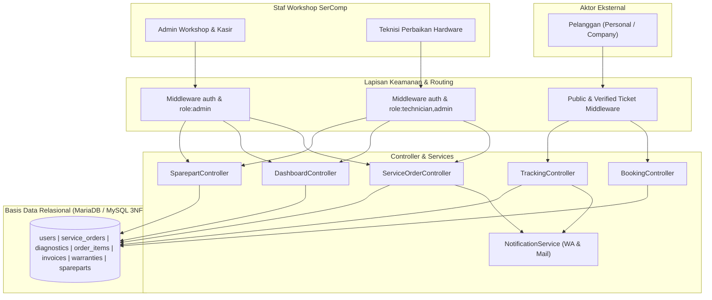
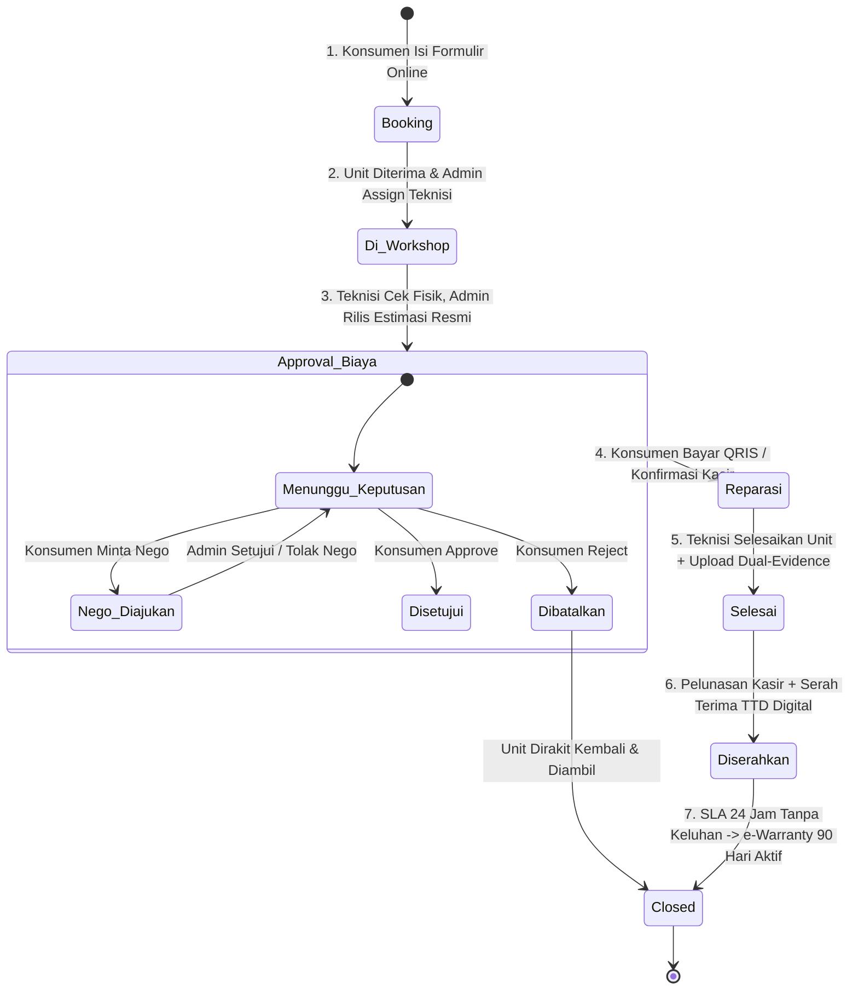

# Dokumentasi Desain Sistem & Arsitektur - SerComp (Digital Workshop System)

Dokumen ini memuat spesifikasi arsitektur teknis, desain logika bisnis, pembagian peran (Role-Based Access Control / RBAC), serta alur kerja (*state machine*) operasional bengkel perbaikan komputer modern **SerComp**.

---

## 1. Ikhtisar Arsitektur Sistem

SerComp dirancang menggunakan arsitektur **Monolith Modern berbasis Laravel 12**, menggabungkan pendekatan *Model-View-Controller (MVC)* dengan *Service Pattern* untuk integrasi notifikasi dan penanganan transaksi *state machine*.

### Diagram Arsitektur Komponen



---

## 2. Matriks Hak Akses & Pembagian Peran (RBAC)

Pemisahan hak akses diterapkan secara tegas menggunakan middleware `role:admin` dan `role:technician,admin` guna mencegah tumpang tindih operasional dan menjaga kerahasiaan data finansial perusahaan.

| Fitur / Modul Operasional | Admin Workshop & Kasir | Teknisi Hardware | Pelanggan / Konsumen |
| :--- | :---: | :---: | :---: |
| **Reservasi Servis (Booking)** | Akses input manual | Tidak | Akses penuh (tanpa login) |
| **Penerimaan Fisik & Assign Teknisi** | **Wewenang Penuh** | Tidak | Hanya melihat status |
| **Diagnosa Fisik & Action Plan** | Review & Otorisasi | **Wewenang Utama** | Hanya membaca hasil |
| **Penetapan Harga Jasa & Part** | **Otoritas Eksklusif** | **Dibatasi (Tersembunyi)** | Hanya menyetujui / Nego |
| **Resolusi Negosiasi Budget** | **Otoritas Eksklusif** | **Dibatasi (Tersembunyi)** | Mengajukan penawaran |
| **Bongkar Unit & Reparasi** | Monitoring SOP | **Wewenang Penuh** | Hanya melihat progress |
| **Upload Foto Dual-Evidence** | Dapat meninjau | **Wajib Melampirkan** | Melihat transparansi bukti |
| **Pembayaran di Tempat (Kasir POS)** | **Wewenang Kasir** | Tidak | Pelunasan saat serah terima |
| **Serah Terima & TTD Digital** | **Wewenang Admin / Kurir** | Tidak | Membubuhkan tanda tangan |
| **Cetak Faktur Invoice A4** | Ya | Tidak | Mengunduh e-Invoice |
| **Katalog & Nilai Valuasi Part** | Akses Penuh & Edit Harga | Hanya lihat stok fisik | Tidak |
| **Dataset BI & Segmentasi CRM** | Akses Penuh (Export CSV) | Tidak | Tidak |

---

## 3. Diagram State Machine (7 Tahap Siklus Servis)

Siklus hidup perbaikan unit mengikuti alur *State Machine* berikut:



---

## 4. SOP & Spesifikasi Teknis Antara Aktor

### A. Alur Kerja Teknisi (Operational Workbench)
1. **Penerimaan Tiket:** Teknisi memantau kartu *"Tugas Baru Di-Assign"* di Dashboard Teknisi. Antrean hanya menampilkan unit yang memiliki `technician_id == auth()->id()`.
2. **Pemeriksaan Fisik Tanpa Beban Finansial:** Teknisi mendokumentasikan temuan kerusakan fisik dan memilih rekomendasi modul komponen yang dibutuhkan dari inventori suku cadang tanpa perlu memikirkan nominal harga jual ke konsumen.
3. **Pengerjaan & Aturan Keamanan (SOP Aman):** Teknisi tidak diperbolehkan membongkar motherboard atau memasang suku cadang sebelum unit beralih ke status `Reparasi` (telah disetujui konsumen).
4. **Validasi Kualitas (Dual-Evidence):** Sebelum menandai unit selesai, teknisi wajib mengunggah:
   - *Bukti 1:* Foto perangkat menyala normal (*running test* suhu stabil).
   - *Bukti 2:* Foto fisik modul suku cadang rusak lama yang dilepas untuk dikembalikan ke pelanggan.

### B. Alur Kerja Admin & Kasir (Workshop Management & Cashier)
1. **Triage & Penugasan:** Admin menerima unit fisik, memverifikasi keluhan awal konsumen, lalu menugaskan (*assign*) teknisi yang sesuai dengan spesialisasi (Level 3 Board, Micro-Soldering, atau PC Desktop).
2. **Kalkulasi & Otorisasi Lembar Estimasi:** Berdasarkan catatan pemeriksaan fisik teknisi, Admin menetapkan tarif jasa teknisi, margin harga komponen, dan catatan garansi resmi.
3. **Manajemen Negosiasi (Nego Resolution):** Jika konsumen mengajukan tawar-menawar harga atau batasan budget, Admin memiliki hak penuh untuk menyetujui dengan penyesuaian nominal jasa/part atau menolak tawaran dengan penjelasan resmi.
4. **Kasir & Pelunasan di Tempat:** Unit yang selesai dapat dilunasi langsung di meja kasir menggunakan metode *Tunai/Cash*, *EDC / Transfer Bank*, maupun *QRIS Dinamis*.
5. **Serah Terima Unit (Handover):** Kasir/kurir meminta verifikasi identitas penerima dan tanda tangan digital di layar sentuh. Serah terima ini otomatis mengaktifkan penghitung mundur toleransi uji *SLA 1x24 jam*.

---

## 5. Ringkasan Skema Basis Data Relasional (3NF)

- **`users`**: Entitas akun terpadu dengan atribut `role` (`admin`, `technician`, `customer`), identitas staf (`tech_code`, `specialization`), dan segmentasi pelanggan (`customer_type`, `company_name`).
- **`service_orders`**: Agregat utama tiket servis (`ticket_no`, `device_brand`, `order_status`, `technician_id`, `unit_handed_over`, `signature_data`, `sla_auto_close_at`).
- **`diagnostics`**: Lembar kerja analisa fisik (`physical_damage_analysis`, `action_plan`, `labor_cost`, `parts_cost`, `net_total_cost`, `evidence_running_test_photo`, `evidence_replaced_part_photo`).
- **`order_items`**: Detail baris suku cadang & add-on terkait order.
- **`invoices`**: Entitas keuangan transaksi (`invoice_no`, `amount_total`, `payment_method`, `payment_status`, `paid_at`).
- **`warranties`**: Sertifikat garansi elektronik pasca-servis (`warranty_code`, `warranty_duration_days`, `starts_at`, `expires_at`, `warranty_status`).
- **`spareparts`**: Katalog inventori fisik workshop (`part_code`, `part_name`, `category`, `stock_qty`, `unit_price`).

---

## 6. Prosedur Pengujian Otomatis (*Automated Testing*)

Seluruh logika bisnis di atas telah diproteksi melalui unit & feature test:
```bash
php artisan test --filter=SercompStateMachineTest
```
Rangkaian pengujian mencakup:
1. *Full 7-stage service lifecycle & SLA timeout auto-close*.
2. Proteksi RBAC isolasi rute Admin terhadap akses Teknisi.
3. Verifikasi filter penugasan teknisi (*technician order visibility isolation*).
4. Mekanisme negosiasi harga dan kalkulasi faktur invoice.
5. Pemisahan tipe pelanggan Personal vs Company korporasi.

---

## 7. Sistem Desain Visual & UI/UX Style Guide (*Design Style*)

Sistem desain antarmuka SerComp mengadopsi filosofi **"Human-Crafted, High-Precision Tech Workshop"**—menghindari tampilan kecerdasan buatan (*AI slop*) yang generik, pastel pucat, atau gradien berlebih. Desain mengutamakan kejelasan hierarki informasi, kepercayaan konsumen (*trust*), dan efisiensi kerja teknisi di lapangan.

### A. Filosofi Desain (Core Design Principles)
1. **Utility & Clarity First:** Informasi kritis (Nomor Tiket, Status Servis, Biaya, dan Penanggung Jawab) disajikan secara menonjol tanpa distraksi visual.
2. **Kesesuaian Aksesibilitas WCAG AA (Kontras Tinggi):** Rasio kontras teks terhadap latar belakang minimal 4.5:1. Badge status tidak menggunakan teks terang di atas latar pastel tanpa kontras pembatas.
3. **Bento Grid & Micro-Depth:** Tata letak modular bergaya kartu *Bento Grid* dengan bayangan halus (*micro-elevation*) dan sudut membulat harmonis (`border-radius: 0.75rem` hingga `1rem`).
4. **Sentuhan Industri Hardware Modern:** Perpaduan warna *Tech Navy* pekat dan *Sapphire Blue* presisi mencerminkan ketepatan teknis lab reparasi hardware komputer.

### B. Palet Warna & Desain Token (Color Tokens)

```
Brand Identity:
├── --sc-navy-dark:      #090d16  (Deep Obsidian Navy - Header & Brand Badge)
├── --sc-navy:           #0f172a  (Tech Navy Utama - Teks & Sidebar Dark)
├── --sc-primary:        #0284c7  (Precision Sapphire Blue - Aksi Utama / Link)
├── --sc-primary-hover:  #0369a1  (State Hover Tombol & Navigasi Aktif)
├── --sc-primary-subtle: #f0f9ff  (Latar Belakang Aksen Tipis / Kartu Aktif)
└── --sc-primary-border: #bae6fd  (Garis Batas Kartu Unggulan)

Neutral Slate Scale:
├── --sc-slate-50:  #f8fafc  (Latar Belakang Layar / Body Canvas)
├── --sc-slate-100: #f1f5f9  (Latar Kartu Sekunder / Box Input)
├── --sc-slate-200: #e2e8f0  (Garis Pembatas / Divider Standar)
├── --sc-slate-400: #94a3b8  (Placeholder & Ikon Non-aktif)
├── --sc-slate-600: #475569  (Teks Sekunder / Keterangan Subtitle)
└── --sc-slate-900: #0f172a  (Teks Utama & Judul Konten)

Status Fungsional Aksesibel (WCAG 4.5:1+):
├── Emerald (Selesai/Lunas) : Text #065f46 | Latar #ecfdf5 | Border #a7f3d0
├── Amber (Menunggu/Nego)    : Text #854d0e | Latar #fffbeb | Border #fde68a
└── Rose (Batal/Kendala)    : Text #991b1b | Latar #fef2f2 | Border #fecaca
```

### C. Tipografi & Hierarki Teks

SerComp menggunakan kombinasi jenis huruf modern yang dioptimalkan untuk keterbacaan antarmuka digital:

- **Huruf Utama (Sans-serif):** `Plus Jakarta Sans`, sans-serif.
  - *Weights:* Regular (400), Medium (500), SemiBold (600), Bold (700), ExtraBold (800).
  - *Body Line-height:* 1.6 untuk keterbacaan instruksi SOP.
- **Huruf Data Teknis (Monospace):** `SFMono-Regular`, Menlo, Monaco, Consolas, monospace.
  - Digunakan khusus untuk: Nomor Tiket (`SC-2026-XXXX`), Nomor Faktur (`INV-XXXX`), Kode SKU Suku Cadang (`FAN-ASUS-G15`), dan Nominal Rupiah pada Kasir.

| Skala Tipografi | Ukuran (Size) | Bobot (Weight) | Penggunaan Utama |
| :--- | :--- | :--- | :--- |
| **Display / Hero** | `2.25rem` (36px) | ExtraBold (800) | Judul Utama Landing Page & Banner Workshop |
| **Heading 1 / Page Title**| `1.5rem` (24px) | Bold (700) | Judul Halaman Dashboard & Meja Kerja |
| **Heading 2 / Card Title**| `1.125rem` (18px) | SemiBold (600) | Judul Kartu Komponen & Tabel |
| **Body Standard** | `0.875rem` (14px) | Regular (400) / Medium (500) | Konten teks, deskripsi keluhan, form input |
| **Caption / Meta** | `0.6875rem` (11px)| Bold (700) Uppercase | Label kategori, waktu diff, status metadata |

### D. Panduan Komponen Antarmuka (UI Components)

1. **Kartu Bento KPI (`.card-kpi`, `.card-bento`):**
   - Latar belakang putih solid dengan batas `1px solid var(--sc-slate-200)`.
   - Efek melayang mikro saat kursor diarahkan: `transform: translateY(-2px)` dengan transisi `cubic-bezier(0.16, 1, 0.3, 1)`.
   - Mengelompokkan data operasional (Antrean, Unit Paid, Dual-evidence, Selesai).

2. **Kotak Ikon Fungsional (`.icon-box-primary`, `.icon-box-success`):**
   - Berukuran tepat `44x44px` dengan `border-radius: 10px`.
   - Memadukan latar pastel transparan 10% dengan ikon Bootstrap Icons berwarna tegas.

3. **Status Badge Aksesibel (`.badge-status-*`):**
   - Bentuk kapsul membulat penuh (*pill badge*).
   - Selalu dilengkapi kombinasi: **Teks Kontras Tinggi + Latar Lembut + Border Tegas**.

4. **Kanvas Tanda Tangan Digital (`#signatureCanvas`):**
   - Responsif terhadap sentuhan jari pada layar tablet kurir maupun klik *mouse* meja kasir.
   - Dilengkapi tombol reset instan dan indikator status *live drawing*.

5. **Aksesibilitas Fokus Keyboard (`:focus-visible`):**
   - Seluruh elemen form (input teks, dropdown part, tombol aksi) memiliki indikator fokus cincin:
     `outline: 2px solid var(--sc-primary)` dengan *offset* 2px.

