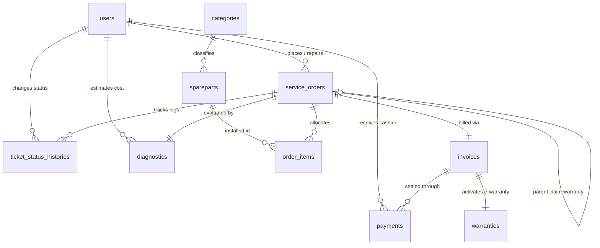

# Dokumentasi Database & Arsitektur Tabel - SerComp

Dokumentasi ini menyajikan spesifikasi relasional basis data, tipe data kolom, indeks, dan pemetaan modul untuk sistem bengkel komputer digital **SerComp (Digital Workshop System)** berbasis Laravel 12 & MariaDB/MySQL.

---

## 1. Diagram Entity-Relationship (ERD Modular)

---

## 2. Struktur Modul & Referensi Cepat

Skema basis data dibagi menjadi **7 modul fungsional** yang dapat ditinjau secara terpisah:

| Modul | Nama Modul | Tabel Terkait | File Dokumentasi |
| :---: | :--- | :--- | :--- |
| **01** | **User & Authentication** | `users`, `password_reset_tokens`, `sessions` | [01_auth_users.md](modules/01_auth_users.md) |
| **02** | **Service Orders & Lifecycle** | `service_orders`, `ticket_status_histories` | [02_service_orders.md](modules/02_service_orders.md) |
| **03** | **Diagnostics & Physical Check** | `diagnostics` | [03_diagnostics.md](modules/03_diagnostics.md) |
| **04** | **Inventory & Spareparts** | `categories`, `spareparts`, `order_items` | [04_inventory_spareparts.md](modules/04_inventory_spareparts.md) |
| **05** | **Billing & Payments** | `invoices`, `payments` | [05_billing_payments.md](modules/05_billing_payments.md) |
| **06** | **Warranty & Aftersales** | `warranties` | [06_warranties_aftersales.md](modules/06_warranties_aftersales.md) |
| **07** | **Business Intelligence (BI)** | `v_bi_executive_summary`, `v_bi_technician_performance`, `v_bi_sparepart_profitability`, `v_bi_aging_receivables` | [07_bi_analytics_views.md](modules/07_bi_analytics_views.md) |

---

## 3. Aturan Integritas & Standar Data Teknis

1. **Precision Currency & Nominal Keuangan:**
   - Seluruh nilai moneter (biaya jasa, harga beli suku cadang/HPP, harga jual, dan pembayaran tagihan) menggunakan tipe data presisi tinggi `DECIMAL(12, 2)` untuk menghindari *floating point rounding errors*.
2. **Foreign Key Constraints:**
   - Relasi ke tiket transaksi utama (`service_order_id`) menggunakan `cascadeOnDelete()` agar data historis pembersihan terjaga sinkron.
   - Relasi ke entitas akun pengguna (`customer_id`, `technician_id`, `received_by`) menggunakan `nullOnDelete()` agar jejak audit keuangan tetap utuh meskipun akun staf dihapus.
3. **Format Standar Penomoran Dokumen Bisnis:**
   - **Nomor Tiket Servis:** `SC-YYYY-XXXX` (cth: `SC-2026-9042`)
   - **Nomor Faktur Tagihan:** `INV-SC-YYYY-XXXX` (cth: `INV-SC-2026-8812`)
   - **Sertifikat E-Warranty:** `#WAR-YYYY-XXXX` (cth: `#WAR-2026-9904`)
   - **Kode Part SKU:** `[KAT]-[BRAND]-[SERI]` (cth: `FAN-ASUS-G15`)
